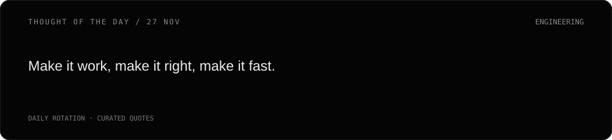

<div align="center">



<br/>


</div>

<br/>

```ts
const prasad = {
  location: "India",
  building:  ["web apps with Next.js", "small tools that make people smile"],
  learning:  ["Python", "Java"],
  funFact:   "my profile redeploys itself every midnight (IST)",
};
```

## `~/pokedex` — ten new Pokémon every day


<sub>Fresh from PokéAPI at midnight IST. The star changes mood by type, season and Indian festival days. Built from my <a href="https://github.com/DEVprasad7/Pokedex-Pokemon-Website-Using-NextJS">Pokédex project</a>.</sub>

## `~/quote`



## `~/projects`

| project | what it does | stack |
| :-- | :-- | :-- |
| [Pokédex](https://github.com/DEVprasad7/Pokedex-Pokemon-Website-Using-NextJS) | Browse Pokémon with live API data | Next.js |
| [Motivational Quotes](https://github.com/DEVprasad7/CodeSprint-Tech-Internship-Task_5-Motivational_Quotes) | Random quote generator (CodeSprint internship) | JavaScript |

## `~/stats`

<div align="center">


</div>

## `~/connect`

[](https://github.com/DEVprasad7)
<!-- Add yours, keep the same black style:
[](https://linkedin.com/in/YOUR-ID)
[](mailto:YOU@example.com)
-->

<div align="center"><sub>

</sub></div>
