  

  <a href="https://github.com/DEVprasad7">GitHub</a> ·
  <a href="https://github.com/DEVprasad7?tab=repositories">Projects</a> ·
  <a href="mailto:YOUR_EMAIL@example.com">Email</a>

---

## `~/about`

Computer Engineering student and developer interested in building practical software—from Python tools and data pipelines to AI-powered applications. I like learning by shipping projects, debugging the details, and turning ideas into something people can use.

## `~/stack`

**Languages** · Python · JavaScript · Java · SQL  
**Web** · React · Next.js · HTML · CSS · Streamlit  
**Backend** · Flask · FastAPI  
**Data / ML** · Pandas · scikit-learn · MySQL · SQLite  
**Tools** · Git · Linux · Docker

Tools I use and learn with; not a claim of expert-level proficiency in every item.

---

## `~/daily-pokedex`

  

Ten Pokémon rotate daily. The featured Pokémon gets a seasonal or calendar-based mood—plus occasional low-key surprises. India-focused calendar moments are represented by dates configured in `data/festivals.json`.

## `~/thought-of-the-day`

  

Short, original reminders about learning, building, and staying curious. Rotates once a day.

## `~/selected-work`

| Project | What it is | Stack |
|---|---|---|
| [ChessMaster](https://github.com/DEVprasad7) | Chess experience with AI opponents and analysis features | Next.js · React · TypeScript |
| [LangChain Gemini Chat](https://geminichatai.streamlit.app/) | Chat app with SQLite authentication and file upload | Python · Streamlit · LangChain |
| [Mumbai House Price Prediction](https://github.com/DEVprasad7) | ML workflow for property-price prediction | Python · Pandas · scikit-learn |
| [Data Engineering Capstone](https://github.com/DEVprasad7) | Hands-on data-pipeline learning project | Python · Data engineering |
| [Pokédex](https://github.com/DEVprasad7/Pokedex-Pokemon-Website-Using-NextJS) | Daily Pokémon discovery with Pokémon API data | Next.js · API |

Replace any project link above that points to the profile root with its exact repository URL before publishing.

## `~/activity`

  
  

## `~/connect`

[GitHub](https://github.com/DEVprasad7) · [Email](mailto:YOUR_EMAIL@example.com) · [LinkedIn](https://www.linkedin.com/in/YOUR-LINKEDIN/)

Built with curiosity, persistence, and too many terminal tabs. · India

profile status: 0 errors · still learning

